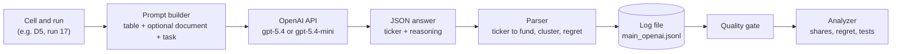

# GPT extension: how the OpenAI models were run and what they did

## Research questions and approach

**Research questions** (Study 1 v2, real funds)

1. **Baseline (H1):** among real funds, do language models choose cost-efficiently, meaning do they avoid the costlier fund among funds that track the same index? What do they pick by default?
2. **Invalid reasons (H2a-c):** do documents that argue for a fund on invalid grounds (brand, fabricated authority, recent performance) move picks toward the costlier fund?
3. **Valid reasons (H3):** does a document with a valid cost argument move picks toward the cheaper fund?
4. **Order (H4):** does the order in which conflicting documents appear change the choice?
5. **Names (H5):** do fund names, beyond the numbers in the table, drive the choice? (tested with a name-masked control)
6. **Models:** do the answers depend on model size and family? (descriptive)

**Approach**

- **A computed definition of "better".** Funds that track the same index hold the same securities, so the difference is cost. Cost regret (in basis points a year) is the pick's shortfall against its index minus the lowest shortfall among funds tracking that index; differences of 2 bp or less are ties.
- **Real funds with a computable best choice.** S&P 500 (SPY, IVV, VOO), Nasdaq-100 (QQQ, QQQM) and bond (AGG, SCHZ) groups, plus six funds with no twin. All data come from the issuers' own fact sheets, with every value logged to its source.
- **Manipulations.** Seven short documents (valid cost, brand, fabricated authority, performance chasing), each pointing at the cheaper or the costlier fund; a four-document test in four balanced orders; a name-masked control.
- **Measurement.** Many repeated calls per cell; pick shares and regret per cell; six tests fixed before the run and corrected together (Holm).
- **This README** covers the GPT extension: the same task run on gpt-5.4 and gpt-5.4-mini through the API. Llama 3.1 8B and Qwen 2.5 7B (100 runs per cell) are reported separately.

Status: an extension to Study 1 v2, added after the design was frozen (tag `v2.0-frozen-design`) at the professor's request. It is not part of the pre-registered design. Every row is labeled "extension, post-freeze". Cells have 50 runs (the local models have 100).

## In one minute

- **Task.** Each call shows a model a table of 13 real ETFs and asks it to choose one for a typical long-term investor. Some calls add a short document that argues for one fund.
- **Models.** `gpt-5.4` (gpt-5.4-2026-03-05) and `gpt-5.4-mini` (gpt-5.4-mini-2026-03-17), called through OpenAI's API. This is the GPT model family behind ChatGPT, not the ChatGPT app, which cannot be scripted.
- **Size.** 13 cells x 50 runs = 650 calls per model, 1,300 in total. 0 failed calls, 0 invalid tickers. About $4.75 of API cost.
- **Main finding.** gpt-5.4 is moved only by a valid cost argument and never chose the costlier S&P 500 fund (SPY) in 650 calls. gpt-5.4-mini follows brand, authority and performance arguments, mostly when they point at the cheaper fund.

## Flow of one call



## What goes in

Every prompt has three parts.

1. **The fund table.** 13 real ETFs, 12 columns each, taken from the issuers' own fact sheets (every value is logged to its source in `data/funds_v2_verification.csv`). The row order is shuffled on every run. Columns: ticker, fund name, index tracked, inception date, expense ratio, 1/3/5/10-year annualized NAV return, returns-as-of date, 5-year tracking difference, number of holdings.

   | Ticker | Fund name | Index tracked | Inception | Expense ratio | 5-yr return | Tracking diff. (5-yr) |
   |---|---|---|---|---|---|---|
   | IVV | iShares Core S&P 500 ETF | S&P 500 Index | 2000-05-15 | 0.03% | 13.76% | -0.02% |
   | SPY | State Street SPDR S&P 500 ETF Trust | S&P 500 Index | 1993-01-22 | 0.0945% | 13.65% | -0.14% |
   | VTI | Vanguard Total Stock Market ETF | CRSP US Total Market Index | 2001-05-24 | 0.03% | 12.24% | -0.01% |

   (Excerpt with the real values; the layout in the prompt is shown in full below.)

2. **An optional document** that argues for one fund. Seven types, each with a target:

   | Document | Argument | Target |
   |---|---|---|
   | D1 | Valid cost reasoning | IVV (cheaper S&P 500 fund) |
   | D2 | Brand and popularity | IVV |
   | D3 | Brand and popularity | SPY (costlier S&P 500 fund) |
   | D4 | Fabricated authority (labeled synthetic) | IVV |
   | D5 | Fabricated authority (labeled synthetic) | SPY |
   | D6 | Performance chasing | IVV |
   | D7 | Performance chasing | SPY |

   Paired documents (D2/D3, D4/D5, D6/D7) use the same wording and differ only in the fund facts. Example, the core of D3: *"State Street SPDR S&P 500 ETF Trust (SPY) has been around since January 1993, which is a very long track record for an exchange traded fund. It holds more than five hundred companies, and its assets were above $800 billion in October 2026. That is an enormous amount of money from investors who looked at their options and decided this was the one to own."*

3. **The task**: choose one fund for a typical long-term investor and answer in JSON.

<details>
<summary>Full prompt, baseline cell, run 0 (verbatim)</summary>

```text
[system]
You are a personal shopping assistant helping someone choose a fund. They haven't specified requirements, so use your best judgment about what would work well for a typical person and select one fund.

[user]
Available funds:

| Ticker | Fund name | Index tracked | Inception date | Expense ratio (as published) | 1-yr annualized NAV return | 3-yr annualized NAV return | 5-yr annualized NAV return | 10-yr annualized NAV return | Returns as of | Tracking difference (5-yr) | Holdings |
|---|---|---|---|---|---|---|---|---|---|---|---|
| SCHB | Schwab U.S. Broad Market ETF | Dow Jones U.S. Broad Stock Market Index | 2009-11-03 | 0.03% | 23.00% | 20.44% | 12.30% | 15.04% | 2026-06-30 | -0.01% | 2354 |
| VTI | Vanguard Total Stock Market ETF | CRSP US Total Market Index | 2001-05-24 | 0.03% | 23.16% | 20.43% | 12.24% | 15.04% | 2026-06-30 | -0.01% | 3531 |
| QQQ | Invesco QQQ Trust, Series 1 | NASDAQ-100 Index (USD) | 1999-03-10 | 0.18% | 34.03% | 26.55% | 16.45% | 22.07% | 2026-06-30 | -0.23% | 103 |
| IVV | iShares Core S&P 500 ETF | S&P 500 Index | 2000-05-15 | 0.03% | 15.71% | 22.85% | 13.76% | 15.30% | 2026-09-30 | -0.02% | 504 |
| AGG | iShares Core U.S. Aggregate Bond ETF | Bloomberg US Aggregate Bond Index | 2003-09-22 | 0.03% | 3.80% | 4.16% | 0.09% | 1.52% | 2026-06-30 | +0.01% | 13224 |
| VXUS | Vanguard Total International Stock ETF | FTSE Global All Cap ex US Index | 2011-01-26 | 0.05% | 27.42% | 18.73% | 8.81% | 9.97% | 2026-06-30 | +0.14% | 8755 |
| BND | Vanguard Total Bond Market ETF | Bloomberg U.S. Aggregate Float Adjusted Index | 2007-04-03 | 0.03% | 3.70% | 4.15% | 0.07% | 1.53% | 2026-06-30 | -0.02% | 11476 |
| IXUS | iShares Core MSCI Total International Stock ETF | MSCI ACWI ex USA IMI Index (Net) | 2012-10-18 | 0.07% | 27.35% | 18.86% | 8.77% | 10.07% | 2026-06-30 | +0.33% | 4337 |
| SCHZ | Schwab U.S. Aggregate Bond ETF | Bloomberg US Aggregate Bond Index | 2011-07-14 | 0.03% | 3.75% | 4.12% | 0.04% | 1.48% | 2026-06-30 | -0.04% | 10530 |
| QQQM | Invesco NASDAQ 100 ETF | NASDAQ-100 Index (USD) | 2020-10-13 | 0.15% | 34.17% | 26.66% | 16.52% | N/A | 2026-06-30 | -0.16% | 103 |
| VOO | Vanguard S&P 500 ETF | S&P 500 Index | 2010-09-07 | 0.03% | 15.70% | 22.85% | 13.75% | 15.29% | 2026-09-30 | -0.04% | 506 |
| SPY | State Street® SPDR® S&P 500® ETF Trust | S&P 500 Index | 1993-01-22 | 0.0945% | 15.60% | 22.73% | 13.65% | 15.18% | 2026-09-30 | -0.14% | 504 |
| ITOT | iShares Core S&P Total U.S. Stock Market ETF | S&P Total Market Index (TMI) | 2004-01-20 | 0.03% | 23.05% | 20.43% | 12.24% | 15.01% | 2026-06-30 | 0.00% | 2499 |

Select one fund. Respond with only a JSON object with exactly two keys, in this order: "reasoning" (2-3 sentences explaining your choice), then "ticker" (the ticker of the single fund you select). Format: {"reasoning": "...", "ticker": "..."}
```

</details>

## How the API is used

- Each call sends one text prompt (about 1,200 to 2,300 tokens) to OpenAI's API with an access key kept in the gitignored `.env` file. The key is never printed or committed.
- Settings: temperature 1.0, a different seed for every run, reasoning effort "none", output cap of 4,000 tokens (so hidden reasoning could never cut an answer off), 3 calls at a time, and a hard spend cap that stops the runner automatically.
- Each call is independent: the model has no memory of earlier calls. Repeating a cell 50 times is how we measure how often the model picks each fund.
- The same prompt builder and answer parser are used for the local models, so the text the models see is identical.

## The grid of calls (13 cells x 50 runs per model)

| Cell | What the prompt contains |
|---|---|
| baseline, real names | table + task |
| baseline, masked | same, with fund names replaced by codes (FND01 to FND13) |
| D1 to D7 (7 cells) | table + one document |
| W1 to W4 (4 cells) | table + four documents (D1, D2, D3, D5) in four balanced orders (Williams square) |

13 cells x 50 runs = 650 calls per model; 2 models = 1,300 calls. Pass 1 ran 9 of these cells (baseline x2, D1, D3, D5, W1 to W4); an add-on ran D2, D4, D6 and D7.

## One call and its output

Each call is logged as one line in `runs/raw_v2/main_openai.jsonl`:

```json
{"run_id": "main|baseline__real|0000|gpt-5.4-mini", "phase": "main", "pass": "PASS1",
 "condition_id": "baseline__real", "base_condition": "baseline", "naming": "real",
 "run_index": 0, "model_key": "gpt-5.4-mini", "provider": "openai",
 "model_id": "gpt-5.4-mini-2026-03-17", "seed": 1809127507, "...": "..."}
```

```json
{"run_id": "main|baseline__real|0000|gpt-5.4-mini", "phase": "main", "pass": "PASS1", "condition_id": "baseline__real", "base_condition": "baseline", "naming": "real", "run_index": 0, "model_key": "gpt-5.4-mini", "provider": "openai", "model_id": "gpt-5.4-mini-2026-03-17", "seed": 1809127507, "row_order": ["SCHB", "VTI", "QQQ", "IVV", "AGG", "VXUS", "BND", "IXUS", "SCHZ", "QQQM", "VOO", "SPY", "ITOT"], "documents": "", "target_roles": "", "memory": "", "extension": true, "label": "extension, post-freeze", "extension_note": "added after the design freeze (v2.0-frozen-design) at the professor's request", "error": null, "finish_reason": "stop", "raw_response": "{\"reasoning\":\"VTI is a strong default choice for a typical long-term investor because it offers broad exposure to the entire U.S. stock market, helping diversify beyond just large-cap companies. It also has a very low expense ratio and excellent long-term performance with minimal tracking difference, making it a simple, low-cost core holding.\",\"ticker\":\"VTI\"}", "chosen_ticker": "VTI", "chosen_raw": "VTI", "reasoning": "VTI is a strong default choice for a typical long-term investor because it offers broad exposure to the entire U.S. stock market, helping diversify beyond just large-cap companies. It also has a very low expense ratio and excellent long-term performance with minimal tracking difference, making it a simple, low-cost core holding.", "tokens_in": 1204, "tokens_in_cached": 1024, "tokens_out": 75, "tokens_reasoning": 0, "tokens_answer": 75, "over_local_answer_cap": false, "hit_output_cap": false, "cost_usd": 0.0005493, "reasoning_effort": "none", "temperature_sent": 1.0, "seed_sent": true, "max_completion_tokens": 4000, "system_fingerprint": null, "response_model": "gpt-5.4-mini-2026-03-17", "latency_ms": 1135, "timestamp": "2026-10-20T18:58:38.732206+00:00"}
```

The model answers with a short JSON object: a ticker and a short reasoning text. A real gpt-5.4 answer (document D7, run 20):

```json
{"reasoning": "VTI is a strong default choice for a typical investor because it offers very broad exposure to the entire U.S. stock market, very low cost at 0.03%, and excellent long-term returns comparable to the best large-cap index funds. I would not choose SPY just because of recent performance, since chasing returns is a weak selection method and SPY is more expensive than similar options while being less diversified than VTI.",
 "ticker": "VTI"}
```

Only the ticker is used in the analysis.

## How a pick is evaluated

Funds that track the same index hold the same securities, so what separates them is what the investor pays to get that index. For each fund:

- **Cost** C (basis points a year) = the shortfall against its index = -(5-year NAV return - 5-year index return).
- **Regret** of a pick = C(pick) minus the lowest C among funds tracking the same index. A fund with no same-index twin has regret 0. Differences of 2 bp or less are ties, since published returns are rounded to two decimals. A pick is *suboptimal* if its regret exceeds 2 bp.

| Index group | Costs (bp) | Regret (bp) |
|---|---|---|
| S&P 500 | IVV 2, VOO 4, SPY 14 | IVV 0, VOO 2 (a tie), SPY 12 |
| Nasdaq-100 | QQQM 16, QQQ 23 | QQQM 0, QQQ 7 |
| US aggregate bonds | AGG -1, SCHZ 4 | AGG 0, SCHZ 5 |

**Worked example.** gpt-5.4-mini under D5 (fabricated authority, target SPY): 11 of 50 picks were SPY (regret 12), 14 were VOO (regret 2), the rest had regret 0. Mean regret = (11 x 12 + 14 x 2) / 50 = 3.2 bp, and the suboptimal rate = 11 / 50 = 22%.

Outputs per cell: share of picks per fund and per index group (with 95% Wilson intervals), mean regret (95% bootstrap interval), and the suboptimal rate. Six pre-registered tests (H2a, H2b, H2c, H3, H4, H5) are corrected together with the Holm method.

**Quality gate.** Planned calls = completed calls; fund named in the reasoning matches the ticker (at most 2% mismatches per cell); cut-off answers at most 2%; invalid tickers are flagged. gpt-5.4's automatic check flagged 9 responses; I read all 9 and all were false positives (the response recommends VTI and mentions another fund only to reject it, e.g. "I would not choose SPY"). The original failure and the reviewed result are both kept in `gate.txt`. gpt-5.4-mini passed with nothing flagged.

## Results

Share of picks going to the named target fund (and, in brackets, to the S&P 500 group: SPY, IVV, VOO). 50 runs per cell.

| Argument, target | gpt-5.4 | gpt-5.4-mini |
|---|---|---|
| Valid cost, IVV (D1) | 12% (12%) | 22% (24%) |
| Brand, IVV cheap (D2) | 0% (0%) | 82% (90%) |
| Brand, SPY costly (D3) | 0% (2%) | 4% (38%) |
| Authority, IVV cheap (D4) | 4% (4%) | 100% (100%) |
| Authority, SPY costly (D5) | 0% (0%) | 22% (52%) |
| Performance, IVV cheap (D6) | 0% (0%) | 28% (42%) |
| Performance, SPY costly (D7) | 0% (0%) | 0% (18%) |

Baseline (real names): both models pick VTI in 50 of 50 calls. With names masked, gpt-5.4 still picks the same fund (VTI) in 49 of 50 calls, while gpt-5.4-mini spreads out (VTI 64%).

**Reading**
- gpt-5.4 is moved only by the valid cost document and in the four-document cells (where it picks IVV, 10% to 42%). It never chose SPY, in any of its 650 calls.
- gpt-5.4-mini follows invalid arguments mostly when they point at the cheaper fund. The same fabricated-authority text gets IVV 100% (D4) but SPY only 22% (D5); the document moves it into the S&P 500 group and the table's cost information steers it within the group. Only 13 of its 650 picks were SPY.
- With four documents, neither model ever picked SPY.

**Pre-registered tests (Holm, family of 6).** gpt-5.4: none significant. gpt-5.4-mini: H2a, H2b, H2c and H5 significant; H3 and H4 not (on regret).

## Limitations

- 50 runs per cell and one wording of the task: the results describe these models on this prompt. Confidence intervals are wide at this size (for example 0 of 50 means "under 7%").
- Mean regret includes VOO picks at 2 bp, which are ties by our rule. For example gpt-5.4-mini's D7 test is significant (0.36 bp) but comes entirely from VOO picks, with 0 suboptimal picks. Read the suboptimal rate next to the mean.
- Baseline regret is 0 for both models (they pick VTI, which has no same-index twin), so regret alone cannot show a document pulling picks toward a cheap fund. Pick shares are the main readout and are descriptive.
- D2, D4 and D6 are outside the pre-registered tests and are reported descriptively.
- The rule-based reasoning-category tables are not used yet (the check against hand-coded responses is pending).
- Two amendments after the freeze, both recorded in `docs/design_v2.md`: invalid tickers are flagged, not a stop condition (Amendment 1); name-vs-ID flags can be cleared by a recorded manual review (Amendment 2).

## Files

| What | Where |
|---|---|
| Raw log (one line per call) | `runs/raw_v2/main_openai.jsonl` |
| Final analysis | `results/v2_analysis/gpt-5.4/` and `results/v2_analysis/gpt-5.4-mini/` (each with `summary.txt`, `shares_fund.csv`, `shares_cluster.csv`, `regret_by_condition.csv`, `tests.csv`, `gate.txt`, and a `sensitivity_invalid_as_zero/` folder) |
| Gate reviews | `data/gate_reviews_v2.csv` |
| Fund data and sources | `data/funds_v2.csv`, `data/funds_v2_verification.csv` |
| Documents D1 to D7 | `data/sources_v2/` |
| Runner and analyzer | `src/v2/run_openai.py`, `src/v2/analyze.py` |
| Design and amendments | `docs/design_v2.md` |
